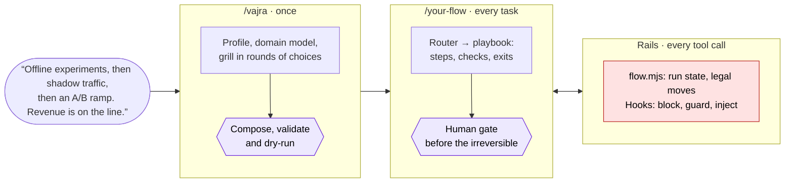
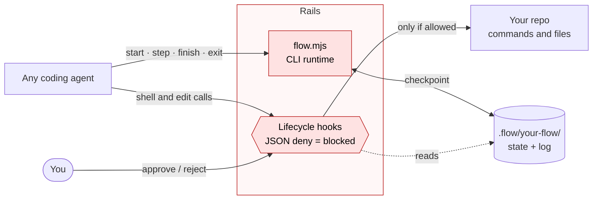
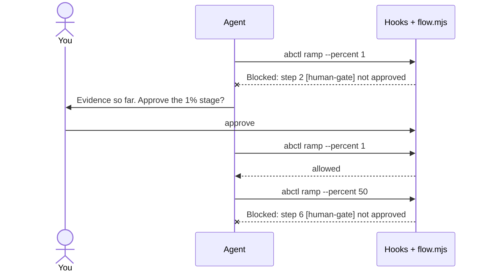
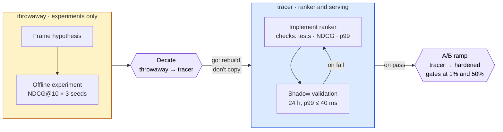
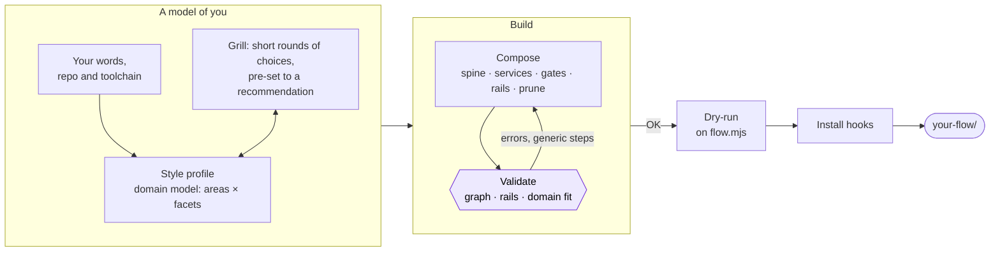
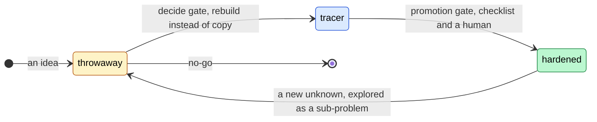

<div align="center">

# ⚡ vajra

**Generate your own workflow skill, and put your agent on rails.**

<sub>A <b>vajra</b> is the thunderbolt of Indian mythology, said to be as unbreakable as a diamond. Like a strike of lightning, vajra finds the shortest path through how you work in an instant; like a diamond, the rails it lays down do not bend.</sub>

A meta skill for AI coding agents. Describe how you work and what you build. It questions you until the plan is tight, then writes a **workflow graph** of playbooks, gates and exits fitted to your domain, plus a **runtime and lifecycle hooks** that enforce it in whichever agent you use. Your agent cannot skip a gate, take an exit the graph does not have, or run a deploy nobody approved.

[](https://github.com/zwire/vajra/actions/workflows/ci.yml)
[](LICENSE)
[](package.json)
[](package.json)
[](https://github.com/vercel-labs/skills)
[](skills/vajra/references/rails.md)
[](skills/vajra/references/rails.md#installing)

[Quick start](#quick-start) · [Usage](#usage) · [Why](#why) · [Rails](#rails-not-reminders) · [How it works](#how-it-works) · [Examples](#examples) · [Validator](#the-validator)

</div>

---



## Quick start

Requires Node.js 18+ and Claude Code, Codex or GitHub Copilot. The generated skill is plain Agent Skills, so other agents can load it, but the hooks are installed and tested for these three.

**1. Install the skill**

```bash
npx skills add zwire/vajra        # add -g to install globally
```

**2. Generate your workflow.** In your agent, invoke vajra by name (for example `/vajra`) and describe how you work:

```
/vajra
Exploratory prototyping that can graduate to production. Solo, a Rails app on Heroku.
```

It reads your repository, asks you a few short rounds of multiple-choice questions, each pre-set to its recommendation (through your agent's question buttons, a one-page form, or plain text; reply "ok" or press Send to accept), then writes, validates and dry-runs a skill such as `.agents/skills/your-flow/`. Other declarations it handles:

- "Two-week sprints, PO-driven backlog, nothing ships without QA sign-off."
- "Robot perception stack with a camera. We have a simulator and one real arm."
- "Analysis notebooks that sometimes turn into nightly pipelines on BigQuery."

**3. Turn on the rails.** At the end it offers to install the hooks for the agents your project uses. You can also do it yourself:

```bash
node <your-flow>/scripts/flow.mjs install --harness claude,codex,copilot   # any subset
```

**4. Work.** Invoke your new skill by name with a task, for example `/your-flow add CSV export to invoices`. The agent picks the playbook and drives the run.

## Usage

### Day to day

| You want to | Do this |
|---|---|
| Start a task on the workflow | Invoke your skill by name with the task |
| Pass a human gate | When the agent stops at a gate, it asks you to choose: tap Approve, or reply `1` (or `approve`), optionally with a note after it |
| Refuse a gate | Tap Reject, or reply `2` (or `reject`) with the reason; the agent takes the exit that fits |
| Let the agent change the workflow itself (a playbook, the project's values, vajra Evolve) | When the agent asks to suspend the rails and says what it will change, tap Suspend or Reject (or reply `1` / `suspend`, `2` / `reject`). It turns them back on when it is done |
| See where the run is, or what happened | Ask the agent; it runs `flow status` and `flow log` |

Every decision is a choice the agent puts to you, so a phone is enough, including for an agent running in the cloud. Where the agent has a choice dialog (Claude Code's AskUserQuestion) you tap it, and Claude Code shows you a line confirming what you picked; otherwise the agent ends its message with the numbered choices and you reply with one. A reply counts only while the agent is waiting for that answer, and only when it starts with the choice's number or name. In a Claude Projects thread your message reaches the hooks inside the thread's envelope; they read your own message out of it, and never another session's. While a gate and a suspend request both wait, a number answers the gate and only `suspend` suspends. With the optional MCP server, clients that support elicitation show the same choices as a dialog. If you do have a terminal, the same decisions work there: `node <your-flow>/scripts/flow.mjs approve --by <you>`, `reject --reason "..."`, `suspend` and `unsuspend`.

The agent's side (`flow start`, `step`, `finish`, `exit`) is written into your skill's `SKILL.md`, so you never type it. Your repository's commands and paths live in `.flow/your-flow/project.md`; commit it. Run state and history live next to it; commit them for an audit trail or ignore `.flow/*/state.json`, `log.jsonl` and `runs/`.

To reuse the skill in another repository of the same kind, copy the skill and run `flow.mjs install --harness ...` there: besides the hooks, it writes a `project.md` skeleton listing every binding the skill needs (an existing one is never overwritten). Fill in the values. Until every one is set, runs refuse to start, and guarded commands whose binding is empty are not recognized, so the hooks cannot block them yet; the session is told so.

### Modes of vajra

vajra runs **only when you invoke it**. What you ask for picks the mode:

| Mode | Ask for example | What it does |
|---|---|---|
| **Generate** | "Make me a workflow: …" | Infers your style profile and domain model, grills you, composes the graph and rails, writes and validates the skill, dry-runs it on the runtime, and installs the hooks for your agents once you say yes |
| **Consult** | "What workflow do I need for …? Don't generate yet." | Runs only the grilling session and recommends a workflow |
| **Evolve** | "We keep skipping the review; update your-flow." | Applies the smallest change to a generated skill after a retro, a phase shift, or a change in risk or domain |
| **Inspect** | "Show me your-flow's graph and what it enforces." | Explains, renders or audits a generated skill and its rails |

## Why

Agents get much more reliable with a **routed playbook skill**: a router that sends each task to a playbook with clear steps, proof requirements and exits. The ones you can download have two problems:

1. **They encode someone else's world**: their team size, their tooling, their risk tolerance, and a generic picture of "your domain".
2. **Following them is optional.** A skill is prose. Under pressure, after a context compaction, or halfway through a long run, the agent skips the review, takes a shortcut past the gate, or runs the deploy because it seemed fine.

vajra fixes both. It builds the graph **around you**, and **enforces** it.

| | A downloaded workflow skill | A skill from vajra |
|---|---|---|
| Fits | Its author's team, stack and risk | Your declared style, your domain model, your exact commands |
| Domain | A preset, or nothing | Built for you at the resolution your work needs; generic steps are flagged |
| Following it | The honor system | A runtime that refuses illegal moves, and hooks that block what the graph forbids |
| Human approval | "Ask the user first" in prose | Only a message from the human passes a gate; the agent cannot approve itself |
| Correctness | Read it and hope | Graph-checked: no dead ends, no trap cycles, no skipped gates |
| Over time | Drifts until abandoned | Evolves after retros and phase shifts, with a recorded history and an audit log |

## Highlights

- **🛤️ Rails, not reminders.** Every generated skill carries `flow.mjs`, a zero-dependency runtime. It tracks which playbook owns the request and refuses exits the graph does not have. It runs each playbook's checks before any exit opens, and red checks route the run down the failure exit. Installed as lifecycle hooks, it blocks guarded irreversible commands until a human approves, limits edits to the paths the active playbook declares, and keeps the agent from touching its own run state, the skill and the hook settings.
- **♻️ Reusable across repositories.** The skill holds your way of working and your domain, never one repository. Commands, paths, URLs and other values of one repository are bindings (`${test}`, `${code}/**`), declared in the skill's `bindings.md` and given per project in `.flow/<skill>/project.md`. The validator rejects literal rails values and warns on repository paths anywhere in the skill.
- **🧩 No lock-in.** The generated skill is plain Agent Skills with spec-only frontmatter and no links outside itself. The runtime is a CLI any agent can run, and the hooks use the protocol current agents share (JSON in, a JSON deny out). One command installs them for Claude Code, Codex and GitHub Copilot (CLI, cloud agent and VS Code), and the three can share one repository in any install order.
- **🎯 Fits your domain, not a preset.** There are no "web" or "robotics" packs. vajra builds a domain model for you, split into areas as finely as the graph needs. It uses ten cross-cutting facets (measured outcome, stand-in ladder, physical world, data mutation…) as a checklist. The validator flags any playbook whose steps or "Done when" name nothing real.
- **🔥 It grills you before it builds, lightly.** It asks short rounds of choices, each pre-set to a recommendation, through your agent's own question tool, a one-page form, or plain text. It pushes back on process you would never run and on safeguards you forgot.
- **🧪 → 🏭 Exploration that can graduate.** Work is labeled `throwaway`, `tracer` or `hardened`. A label rises only through a gate that declares the raise, and spike code is rebuilt instead of promoted. Throwaway playbooks declare `writes` limited to their scratch paths, and the hooks hold edits to them.
- **✅ Machine-checked.** The validator checks the graph, the gates, the rails and the domain fit, and whether the graph matches your profile.
- **🔁 Evolves with you.** Retros and phase shifts go through Evolve mode, which applies the smallest change to the graph. Every run is logged in `.flow/`, so you can see where the workflow actually hurts.

<details>
<summary>Why there are no "Works with" caveats for a single agent</summary>

The skill format follows the Agent Skills specification exactly: `SKILL.md` frontmatter uses only its fields, and every link resolves inside the skill directory, which the test suite checks. Agent-specific details live in one place, the installer's table of configuration files. Explicit invocation is expressed in the description, which every agent reads, rather than through one agent's private frontmatter flag.

</details>

## Rails, not reminders

Graph engineering, as agent frameworks practice it, is a state machine. Code owns the transitions between states, and the model works inside each state. State is checkpointed, and the run is interrupted for a human, then resumed. vajra builds that model on files and on interfaces every coding agent already has. The agent drives the run through `flow.mjs`; the hooks see every shell and edit call, and let through only what the run allows.



| Concept | In agent graph frameworks | In a generated skill |
|---|---|---|
| Node / edge | Function or sub-agent / transition | Playbook / exit |
| Conditional edge | Chosen by code from a result | `on: pass` / `on: fail`, chosen by the playbook's `checks` |
| Checkpoint | Saved state per thread | `.flow/<skill>/state.json` per run, plus an append-only log |
| Interrupt / resume | Pause for human input, resume with a command | `[human-gate]` waits; only the human's `approve` / `reject` resumes it |

| Layer | Standard | Role |
|---|---|---|
| Packaging | Agent Skills | Any agent that loads skills can load the generated skill |
| Driving the run | Plain CLI (`node scripts/flow.mjs …`) | Every agent can run it, and it costs no context until used |
| Enforcement | Lifecycle hooks (JSON on stdin, a JSON deny blocks) | Blocks and context injection that work whether or not the agent cooperates |
| Optional | MCP elicitation | A gate dialog the model cannot answer, for clients that support it (off by default: MCP tools cost context every session) |

A gated rollout in the example `search-ranking-flow`. The agent never decides on its own that the ramp may widen:



<details>
<summary>The same exchange as the runtime prints it</summary>

`flow` stands for `node .agents/skills/search-ranking-flow/scripts/flow.mjs`.

```console
$ flow start ab-ramp --request "ramp model 0412"
$ (agent) abctl ramp search-ranker-0412 --percent 1
[search-ranking-flow] Blocked: `abctl ramp` belongs to step 4 and step 2 [human-gate] is not approved. Run `flow step 2`, then stop and ask the user.
$ flow step 2
STOP. Step 2 is a human gate: "The product owner approves the held-out evaluation and the 1% stage."
Present what the user needs to decide, then ask the user whether step 2 may pass, as a choice: […] otherwise by ending your message with "1. Approve  2. Reject". […]
$ (agent) flow approve
[search-ranking-flow] Blocked: only the user can approve, reject or suspend, and flow.mjs hook and mcp are run by the agent harness, not from the shell. At a human gate, stop and ask the user whether step <n> may pass, as a choice: […]
> (user) 1, go to 1%
[search-ranking-flow] The user approved step 2 of ab-ramp.
$ (agent) abctl ramp search-ranker-0412 --percent 1                    # allowed
$ flow step 3 --evidence "..."; flow step 4 --evidence "1% started"
$ (agent) abctl ramp search-ranker-0412 --percent 50
[search-ranking-flow] Blocked: `abctl ramp` belongs to step 7 and step 6 [human-gate] is not approved. Run `flow step 6`, then stop and ask the user.
```

</details>

| Enforced | How |
|---|---|
| Only declared exits, only after "Done when" | `flow exit` refuses anything else; `flow finish` needs every step recorded |
| Checks decide the branch | `checks:` run on finish; exits marked `on: pass` / `on: fail` open accordingly |
| Human gates pass only by the human | The human picks Approve or Reject: the prompt hook reads the pick from their own message, the post-tool hook from a choice dialog the agent could not pre-fill, or the human runs `flow approve` in their own terminal; the agent's attempts are blocked |
| Only the human switches the rails off | The agent asks with `flow request suspend --reason "..."`; the hooks suspend the rails only when the human then picks Suspend. The agent turns them back on with `flow unsuspend` |
| Irreversible commands wait for their gate | The tool hook matches `irreversible:` patterns and checks the gate before the step the command belongs to. When steps behind different gates run the same command (two ramp stages), it is matched against each step's own command, and a later stage never passes on an earlier stage's approval |
| Throwaway stays throwaway | `writes: [${scratch}/**]` limits edits while a throwaway playbook is active; `writes: []` makes a playbook read-only |
| The agent stays oriented | Current playbook and next move are injected at session start and on every prompt during a run (Copilot CLI drops prompt-hook output, so there only at session start); stopping mid-playbook is bounced once per state of progress |

Three levels (`advisory`, `standard`, `strict`) come from your profile. Install the hooks for the agents you use:

```bash
node <your-flow>/scripts/flow.mjs install --harness claude,codex,copilot   # any subset
node <your-flow>/scripts/flow.mjs install --harness claude --scope local   # personal settings only
node <your-flow>/scripts/flow.mjs install --harness codex --dry-run        # print the files instead of writing them
```

| `--harness` | Hooks file |
|---|---|
| `claude` | `.claude/settings.json` (`.claude/settings.local.json` with `--scope local`) |
| `codex` | `.codex/hooks.json`; Codex runs it once the project is trusted and you have reviewed the hooks with `/hooks` |
| `copilot` | `.github/hooks/<your-flow>.json`, read by Copilot CLI, cloud agent and VS Code |

Copilot also runs the hooks in `.claude/settings.json`; the installed commands notice that and run each event once. `--mcp` also registers the optional MCP server (`.mcp.json` for Claude Code, `.codex/config.toml` for Codex; by hand for Copilot).

The [rails reference](skills/vajra/references/rails.md) spells out what is enforced, and also where enforcement ends: choices between legal exits remain the agent's judgment, `writes` covers the agent's edit tools but not files changed by shell commands, and an agent without hooks is held only by the runtime it drives.

## Same tool, different people, different graphs

| You say | You get |
|---|---|
| *"Offline experiments on click logs, then shadow traffic, then an A/B ramp. Revenue is on the line."* | Hypothesis → offline experiment → **decide** → ranker build with NDCG and latency checks → shadow validation → **A/B ramp** where the held-out week is spent once and the 1% and 50% stages each wait for the product owner. [Graph](examples/search-ranking-flow/graph.md) |
| *"Pick-and-place arm, ROS 2, Gazebo, one real arm. Sim first; the arm must be safe."* | Spikes in Gazebo and on bags → **decide** → increment → sim scenarios → **hardware trial** with an operator gate. The arm launch is a guarded command, and every playbook's `writes` leaves the safety limits file out. [Graph](examples/robot-grasp-flow/graph.md) |
| *"Two-week sprints, QA sign-off. B2B invoicing; customers' ERPs call our API."* | Sprint spine, expand-then-contract API changes with an OpenAPI breaking-change check, and a **QA release gate** with a migration dry run. Triggers automatically. [Graph](examples/scrum-team-flow/graph.md) |
| *"Infusion pump software, IEC 62304 class B. Traceability, named approver."* | V-model with trace checks that route pass and fail, guarded baseline and release commands, and strict rails: no edit without an active playbook. [Graph](examples/medical-v-model-flow/graph.md) |

The first one, simplified:



## How it works



**Development style decides the topology.**

- Uncertainty, requirement stability and cadence pick the spine: stabilize (when chaotic), discovery, plan-driven, sprint, or flow.
- The phase journey (explore → expand → extract) decides which lifecycles and promotion gates exist.
- Failure cost decides gate strictness, review depth and the rails level.
- Cadence, team size, verification posture, autonomy and parallelism tune each playbook.

Work moves between three lifecycles, and only gates move it up:



Throwaway playbooks may edit only their scratch paths, and the hooks guard the deploys of hardened work. A sub-problem explored from hardened work re-enters through the decide gate; hardened code is never relabeled.

**The domain model decides the work.** It is built for you, not picked from a list. Areas are split only as finely as the graph needs: perception and motion on a robot, the ranking model and the serving path in search. Each area gets its [facets](skills/vajra/references/facets/README.md), an evidence ladder from cheapest to real, the irreversible actions with their commands, lead times and vocabulary. Each facet says where those facts must show up: which evidence, which gates, which guarded commands. The facts themselves come from your repository and your answers. Physical safety rules always win.

### What you get

```
your-flow/
├── SKILL.md          router: request type → entry playbook; runs go through flow.mjs
├── playbooks/*.md    nodes: steps, "Done when", exits, plus checks / writes / irreversible rails
├── principles.md     only the principles your graph needs
├── profile.md        your profile (machine-readable), domain model, interview log
├── bindings.md       the repository values the skill needs, by name (${test}, ${code}, ${deploy})
├── graph.md          Mermaid graph, rendered by the validator
└── scripts/
    ├── flow.mjs      the runtime: CLI, lifecycle hooks, optional MCP server
    ├── validate.mjs  the validator (also used by the runtime)
    └── lib/          their modules: the hooks' shell and tool-call checks, run transitions, install, MCP

.flow/your-flow/project.md   per repository, outside the skill: the values and the repository facts
```

A playbook's frontmatter is both the graph and its rails, with this repository's values as bindings:

```yaml
---
id: shadow-validation
title: Shadow validation
phase: expand
lifecycle: tracer
kind: work
checks:
  - ${shadow-check}
exits:
  - to: ab-ramp
    when: 24 hours of shadow traffic stayed within the budget
    on: pass
  - to: implement-ranker
    when: latency or errors broke the budget
    on: fail
---
```

The value lives in the project file, one line per binding in its frontmatter:

```yaml
# .flow/search-ranking-flow/project.md
---
shadow-check: python -m rankeval shadow --model shadow --since 24h --max-p99-ms 40 --max-error-rate 0.001
# … one line per binding
---
```

## The validator

```bash
node skills/vajra/scripts/validate.mjs path/to/your-flow [--project path/to/repo] --write-graph
```

| Checks | Severity |
|---|---|
| Missing exit targets, unreachable playbooks, trap cycles with no way to an end | error |
| A lifecycle raised without a gate that declares it, including detours through service playbooks | error |
| Work entering a promotion gate below the gate's level (throwaway code at a production gate) | error |
| `[irreversible]` steps without a preceding `[human-gate]` | error |
| Invalid frontmatter or unsupported YAML, malformed rails, missing or empty required sections, schema version mismatch | error |
| Rails values written as literals instead of bindings; bindings used but not declared; with `--project`, bindings the project leaves unset | error |
| Paths, globs or URLs of one repository anywhere in the skill | warning |
| Steps or "Done when" that name nothing concrete; a missing domain model | warning |
| Router description that does not state the profile's explicit invocation; unknown frontmatter keys | warning |
| Irreversible steps without guarded commands; kept code without checks; rails too weak for the risk | warning |
| The profile's journey needs a promotion gate the graph lacks; regulated gates without a human gate | warning |
| `SKILL.md` frontmatter outside the Agent Skills specification; `name` not matching the directory | error |
| Missing or outdated runtime in the generated skill | warning |

It writes `graph.md` only when there are no errors. Node 18+, no dependencies.

## Examples

Complete generated skills, also used as test fixtures. See [examples/](examples/README.md).

| Example | Style | Facets | Rails |
|---|---|---|---|
| [search-ranking-flow](examples/search-ranking-flow/) | Discovery → serving ladder | measured-outcome, data-dependence, stand-in-ladder, resource-budgets | standard |
| [robot-grasp-flow](examples/robot-grasp-flow/) | Discovery → flow, hardware | physical-world, stand-in-ladder, data-dependence, measured-outcome | strict |
| [scrum-team-flow](examples/scrum-team-flow/) | Sprint, team of five | shared-contracts, data-mutation | standard |
| [medical-v-model-flow](examples/medical-v-model-flow/) | Plan-driven, regulated | reproducibility, external-release, stand-in-ladder | strict |

## Evals

[`evals/`](evals/README.md) holds structural evals. Each case has a declaration, interview answers, and assertions such as *"every irreversible step has a guarded command"*, *"no generic steps"* or *"the gates promote throwaway → tracer and something → hardened"*. Playbook names are never asserted. Cases with a reference example must pass on it in `npm test`. The `crop-drone` case has no example and is for live runs only: it tests how the generator handles a domain it has never seen.

## Repository layout

```
skills/vajra/       the installable meta skill
├── SKILL.md                  entry point and mode router
├── workflows/                generate, consult, evolve, inspect
├── references/               profile axes, composition, domain model, rails, gates and lifecycles,
│   ├── facets/               graph model, authoring, calibration; cross-cutting domain facets
│   └── blueprints/           playbook blueprints (one file each)
├── templates/                skeletons for generated files, and the consult round spec
└── scripts/
    ├── validate.mjs          validator and graph renderer
    ├── interview.mjs         consult rounds as chat text, a one-page form, or a local form
    ├── flow.mjs              runtime (CLI, hooks, optional MCP), copied into every generated skill
    └── lib/                  modules of the runtime and the validator, copied with them
examples/                     generated skills (calibration and test fixtures)
evals/                        structural eval cases and runner
tests/                        npm test
```

## Development

```bash
npm test            # validator, runtime, hooks, MCP, examples, blueprints, evals, docs-vs-code, self-containment
npm run examples    # refresh the runtime copies in examples/ and re-render their graphs
```

## License

[MIT](LICENSE)
