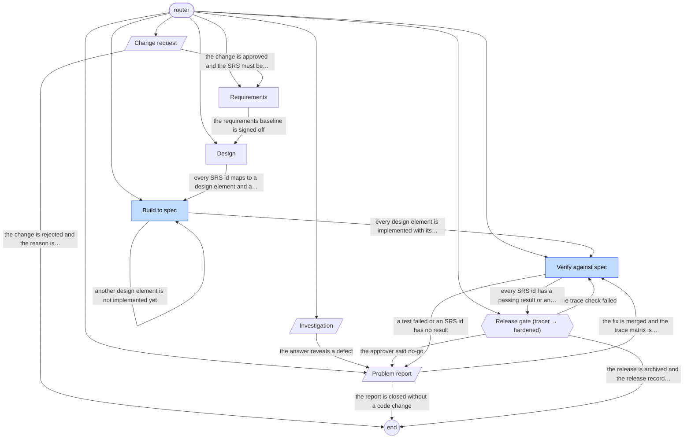

# medical-v-model-flow workflow graph

Generated by `vajra/scripts/validate.mjs --write-graph`. Do not edit by hand; edit playbook frontmatter and regenerate.

| Playbook | Kind | Phase | Lifecycle | Exits to |
|---|---|---|---|---|
| [build-to-spec](playbooks/build-to-spec.md) | work | expand | tracer | build-to-spec, verify-against-spec |
| [change-request](playbooks/change-request.md) | service | any | any | requirements, end |
| [design](playbooks/design.md) | work | any | any | build-to-spec |
| [investigation](playbooks/investigation.md) | service | any | any | problem-report |
| [problem-report](playbooks/problem-report.md) | service | any | any | verify-against-spec, end |
| [release-gate](playbooks/release-gate.md) | gate (tracer → hardened) | extract | any | end, problem-report, verify-against-spec |
| [requirements](playbooks/requirements.md) | work | any | any | design |
| [verify-against-spec](playbooks/verify-against-spec.md) | work | extract | tracer | release-gate, problem-report |
