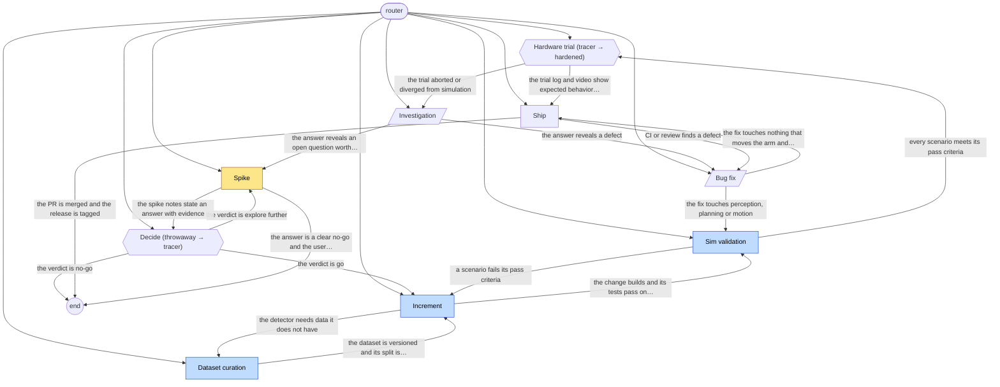

# robot-grasp-flow workflow graph

Generated by `vajra/scripts/validate.mjs --write-graph`. Do not edit by hand; edit playbook frontmatter and regenerate.

| Playbook | Kind | Phase | Lifecycle | Exits to |
|---|---|---|---|---|
| [bug-fix](playbooks/bug-fix.md) | service | any | any | sim-validation, ship |
| [dataset-curation](playbooks/dataset-curation.md) | work | expand | tracer | increment |
| [decide](playbooks/decide.md) | gate (throwaway → tracer) | explore | any | increment, spike, end |
| [hardware-trial](playbooks/hardware-trial.md) | gate (tracer → hardened) | extract | any | ship, investigation |
| [increment](playbooks/increment.md) | work | expand | tracer | dataset-curation, sim-validation |
| [investigation](playbooks/investigation.md) | service | any | any | bug-fix, spike |
| [ship](playbooks/ship.md) | work | any | any | end, bug-fix |
| [sim-validation](playbooks/sim-validation.md) | work | expand | tracer | increment, hardware-trial |
| [spike](playbooks/spike.md) | work | explore | throwaway | decide, end |
