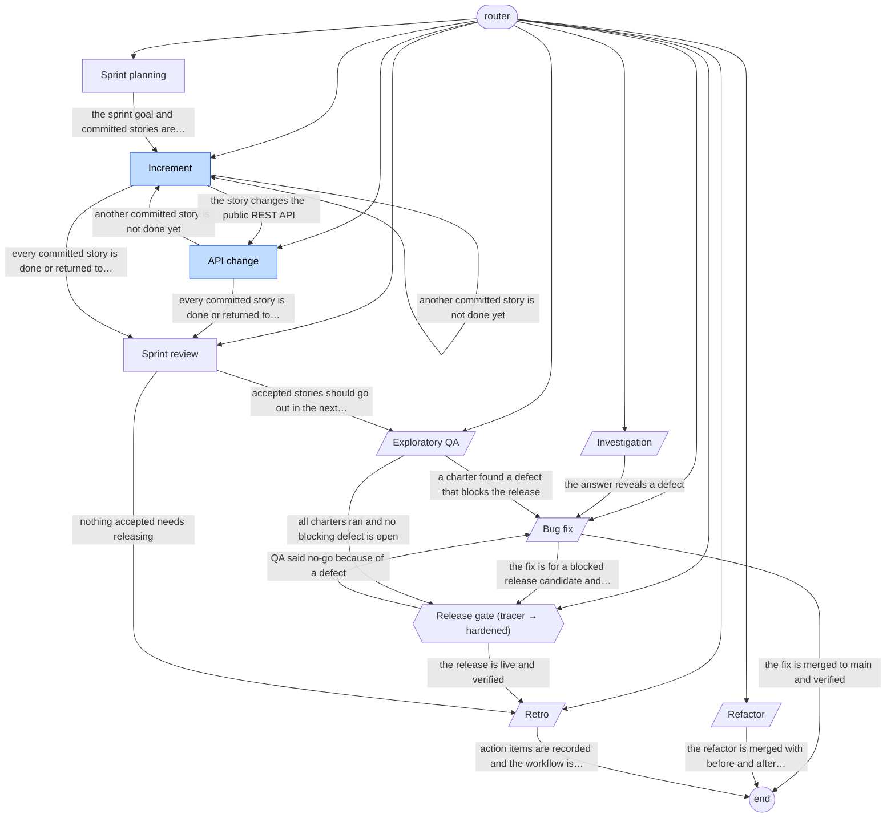

# scrum-team-flow workflow graph

Generated by `vajra/scripts/validate.mjs --write-graph`. Do not edit by hand; edit playbook frontmatter and regenerate.

| Playbook | Kind | Phase | Lifecycle | Exits to |
|---|---|---|---|---|
| [api-change](playbooks/api-change.md) | work | expand | tracer | increment, sprint-review |
| [bug-fix](playbooks/bug-fix.md) | service | any | any | release-gate, end |
| [increment](playbooks/increment.md) | work | expand | tracer | api-change, increment, sprint-review |
| [investigation](playbooks/investigation.md) | service | any | any | bug-fix |
| [qa-exploratory](playbooks/qa-exploratory.md) | service | any | any | bug-fix, release-gate |
| [refactor](playbooks/refactor.md) | service | any | any | end |
| [release-gate](playbooks/release-gate.md) | gate (tracer → hardened) | extract | any | retro, bug-fix |
| [retro](playbooks/retro.md) | service | any | any | end |
| [sprint-planning](playbooks/sprint-planning.md) | work | any | any | increment |
| [sprint-review](playbooks/sprint-review.md) | work | any | any | qa-exploratory, retro |
