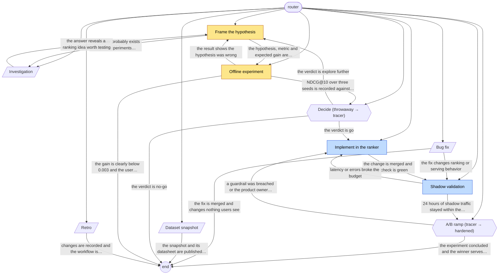

# search-ranking-flow workflow graph

Generated by `vajra/scripts/validate.mjs --write-graph`. Do not edit by hand; edit playbook frontmatter and regenerate.

| Playbook | Kind | Phase | Lifecycle | Exits to |
|---|---|---|---|---|
| [ab-ramp](playbooks/ab-ramp.md) | gate (tracer → hardened) | extract | any | end, implement-ranker |
| [bug-fix](playbooks/bug-fix.md) | service | any | any | shadow-validation, end |
| [dataset-snapshot](playbooks/dataset-snapshot.md) | service | any | any | end |
| [decide](playbooks/decide.md) | gate (throwaway → tracer) | explore | any | implement-ranker, frame-hypothesis, end |
| [frame-hypothesis](playbooks/frame-hypothesis.md) | work | explore | throwaway | offline-experiment, investigation |
| [implement-ranker](playbooks/implement-ranker.md) | work | expand | tracer | shadow-validation |
| [investigation](playbooks/investigation.md) | service | any | any | frame-hypothesis |
| [offline-experiment](playbooks/offline-experiment.md) | work | explore | throwaway | decide, frame-hypothesis, end |
| [retro](playbooks/retro.md) | service | any | any | end |
| [shadow-validation](playbooks/shadow-validation.md) | work | expand | tracer | ab-ramp, implement-ranker |
